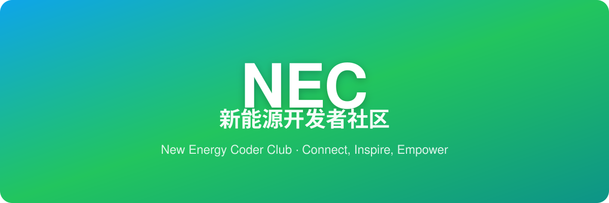

<!-- NEC Organization Profile README -->
<!-- 此文件位于 .github/profile/README.md，渲染为 GitHub 组织首页 (https://github.com/new-energy-coder-club) -->

# ⚡ NEC 新能源开发者社区

**New Energy Coder Club** · 连接、启发、赋能新能源领域的开发者与爱好者

---

## 🚀 关于我们

NEC 是一个聚焦 **新能源 × 机器人竞赛 × 开源实战** 的工程社区。我们围绕四个方向持续沉淀、协作与成长：

| 方向 | 我们在做什么 |
|:---:|:---|
| 🤖 **机器人竞赛** | CURC / RoboCon 系列赛事备赛资料、开源工程与经验复盘 |
| ⚡ **新能源嵌入式** | 电控、电机驱动、光伏储能等可落地的实战项目 |
| 📖 **知识沉淀** | 学习路线、技术文档、赛事规则整合（LeggedWiki 等） |
| 🤝 **开源协作** | 模板化项目结构、贡献指南、贡献者成长体系 |

## 📦 核心仓库

| 仓库 | 说明 | 技术栈 |
|---|---|---|
| [new_energy_coder_club](https://github.com/new-energy-coder-club/new_energy_coder_club) | 社区主仓库：竞赛资料、开源项目、技术文档 | Markdown / 资料库 |
| [newenergycoder.club](https://github.com/new-energy-coder-club/newenergycoder.club) | 社区官网，展示社区动态与项目入口 | React + Vite |

## 🔗 快速入口

| 入口 | 链接 |
|---|---|
| 🏠 组织主页 | https://github.com/new-energy-coder-club |
| 🌐 社区官网 | https://www.newenergycoder.club |
| 📚 主仓库 | https://github.com/new-energy-coder-club/new_energy_coder_club |
| ⚙️ 本仓库 | https://github.com/new-energy-coder-club/.github |

## 🙌 加入我们

- 🌐 访问官网：[https://www.newenergycoder.club](https://www.newenergycoder.club)
- 📖 阅读贡献指南：[CONTRIBUTING.md](https://github.com/new-energy-coder-club/new_energy_coder_club/blob/main/CONTRIBUTING.md)
- 💬 通过官网「加入我们」页面找到社区入口

## 👥 贡献者

感谢每一位为 NEC 社区贡献代码、文档和想法的伙伴！

## 💡 社区理念

**连接 · 启发 · 赋能**

*Connect, Inspire, Empower*

